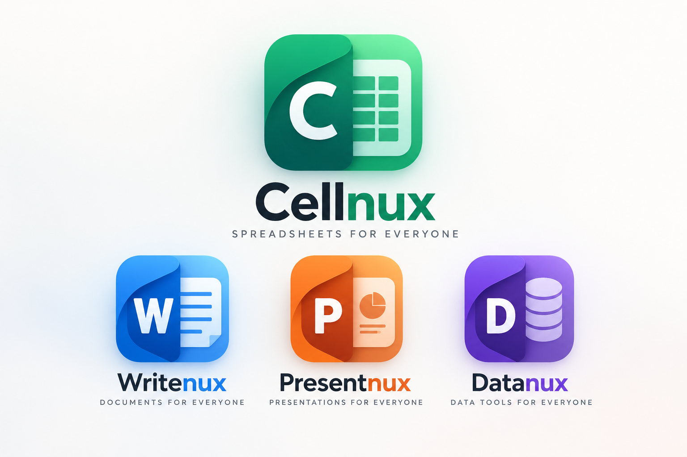

# NuxOffice

**A Linux-first, open-source, high-performance office suite.**

The first and flagship application is **Cellnux**, a spreadsheet editor built for real-world `.xlsx` files, progressive VBA compatibility and a modern, sandboxed scripting platform. Writenux (documents), Presentnux (presentations) and Datanux (data tools) will follow on the same foundations.

> **Status: Phase 0 — research and proof of concept.**
> There is no runnable application yet. The repository holds the product blueprint, the engineering skeleton (Rust workspace, CI, contribution process), the core data-model crate and the first slice of the formula engine. Contributions that move Phase 0 forward are very welcome.

<p align="center">
  
</p>

## The suite

| App | Purpose | Color | Status |
|---|---|---|---|
| **Cellnux** | Spreadsheets | Emerald green | Flagship, Phase 0 |
| **Writenux** | Documents | Blue | Planned (Phase 5) |
| **Presentnux** | Presentations | Orange | Planned (Phase 5) |
| **Datanux** | Databases and data tools | Purple | Planned (Phase 5) |

## Why another office suite?

- **Linux-first.** Fedora, Ubuntu, Debian and other major distributions are the primary targets. Windows and macOS come later on portable foundations.
- **Fast.** Fast startup, low memory and responsive navigation on very large sheets. Measured with reproducible benchmarks, never claimed.
- **Compatible.** High fidelity with Microsoft Office file formats, implemented independently from public specifications. User data is never silently destroyed.
- **Automatable.** Incremental VBA compatibility for legacy `.xlsm` workbooks, plus a safer and more capable JavaScript/TypeScript automation API.
- **Open.** Developed in public with reproducible builds, tests, benchmarks and architecture decision records.

## Architecture at a glance

| Layer | Preferred technology | State |
|---|---|---|
| Spreadsheet core | Rust workspace (`crates/`) | `cellnux-core` and `cellnux-formulas` started |
| Desktop UI | Qt 6 + QML with a virtualized grid (`apps/cellnux-desktop`) | Spike pending |
| Core/UI boundary | Stable versioned C ABI or tested bindings | ADR pending |
| File formats | OOXML (`.xlsx`, `.xlsm`) and CSV first; ODS and legacy `.xls` later | Library review pending |
| Modern scripting | Embedded JavaScript/TypeScript runtime with capability-based sandbox | Phase 3 |
| VBA | Separate parser and runtime with an Excel-like object model | Phase 4 |

These are proposals to validate with spikes, not final decisions. See [docs/architecture](docs/architecture/README.md) and the [ADR log](docs/adr/README.md).

## Repository layout

```text
NuxOffice/
├── apps/cellnux-desktop/   Qt 6 / QML desktop application (spike pending)
├── crates/                 Rust workspace: cellnux-core, then formulas, formats, api, vba, scripting
├── docs/                   Blueprint, architecture, ADRs, compatibility, benchmarks, roadmap
├── design/                 Brand reference and original vector icons
├── fixtures/               Reproducible sample files for format and formula tests
├── benchmarks/             Benchmark harness and methodology
├── tests/                  Cross-crate integration tests
├── scripts/                Developer tooling
└── .github/                CI workflows, issue and PR templates
```

Each directory has its own `README.md` describing its purpose and current state.

## Getting started (developers)

Requirements: a stable Rust toolchain (`rustup` installs the pinned version from `rust-toolchain.toml`).

```bash
git clone https://github.com/DrM7md/NuxOffice.git
cd NuxOffice
cargo build --workspace
cargo test --workspace
cargo clippy --workspace --all-targets -- -D warnings
cargo fmt --all --check
```

The Qt desktop application does not build yet. Follow [apps/cellnux-desktop](apps/cellnux-desktop/README.md) for the spike plan.

## Roadmap

1. **Phase 0 — Research and proof of concept.** License decision, library and license review, Rust/Qt interop spike, virtualized grid spike, baseline benchmarks, first ADRs. See the [Phase 0 checklist](docs/roadmap/phase-0-checklist.md).
2. **Phase 1 — Usable spreadsheet alpha.** Multi-sheet workbook, formula bar, basic styles, undo/redo, `.xlsx` and `.csv` round-trip, 20+ documented functions.
3. **Phase 2 — Productivity beta.** Rich formatting, sort and filter, freeze panes, charts, large-file optimizations, Hijri dates and Arabic-Indic digits, differential testing against LibreOffice, Flatpak packaging.
4. **Phase 3 — Spreadsheet API, modern scripting and plugins.** Versioned Spreadsheet API, TypeScript SDK, sandboxed JS runtime, permissions, debugger, SQLite and HTTP adapters.
5. **Phase 4 — VBA compatibility alpha.** `.xlsm` preservation, VBA language subset, core object model on top of the Spreadsheet API, consent-gated execution.
6. **Phase 5 — Suite expansion.** Writenux, Presentnux and Datanux.

## Read the blueprint

Vision, architecture, file-format strategy, security model, benchmark plan and acceptance criteria live in one document:

**[docs/Cellnux_Project_Blueprint.md](docs/Cellnux_Project_Blueprint.md)**

New contributors should read it before writing code. AI coding agents must also read [AGENTS.md](AGENTS.md).

## Contributing

Help is needed across Rust, Qt/QML, OOXML, VBA, JavaScript runtimes, design, localization, documentation and benchmarking. Start with [CONTRIBUTING.md](CONTRIBUTING.md), then open or pick an issue.

Good first steps for Phase 0:

- Compare open-source spreadsheet engines and OOXML libraries (license, maintenance, format coverage) and write an ADR.
- Build a Rust/Qt interoperability spike and report what works.
- Build a Qt virtualized grid spike that scrolls a million rows smoothly.
- Add the dependency graph and incremental recalculation to `cellnux-formulas` (ADR 0002).
- Implement more functions with fixtures: `SUMIF`, `COUNTIF`, `VLOOKUP`, `INDEX`, `MATCH`.
- Add property-based tests and a fuzz target for the formula parser.
- Design reproducible benchmark fixtures.
- Recreate the approved icon reference as original vector SVG artwork.

## License

NuxOffice is licensed under the **Mozilla Public License 2.0** ([LICENSE](LICENSE)). The reasoning is recorded in [ADR 0005](docs/adr/0005-project-license.md). Contributions are accepted under the Developer Certificate of Origin: sign off every commit (see [CONTRIBUTING.md](CONTRIBUTING.md)).

## Trademarks and originality

NuxOffice, Cellnux, Writenux, Presentnux and Datanux are original product names. This project contains no proprietary Microsoft code, fonts, logos or copied UI assets, and claims no Excel or VBA compatibility beyond what automated tests verify. Microsoft, Excel and Office are trademarks of Microsoft Corporation.
